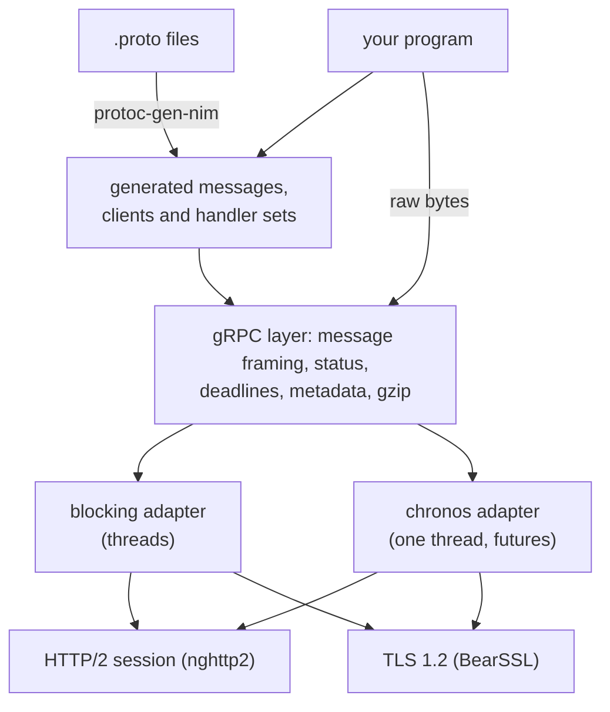

# nimgrpc

[](https://www.bestpractices.dev/projects/16176)

nimgrpc is a gRPC library for Nim: a Nim program uses it to call and to serve gRPC methods
(unary and streaming, over plaintext HTTP/2, TLS or mutual TLS) and so to talk to gRPC programs
written in any other language. It is built on [nghttp2](https://nghttp2.org) and BearSSL.

## When to use it, and when not

Use it when:

- a Nim program must be a gRPC client or server, with code generated from `.proto` files or on
  raw message bytes;
- you want threads and blocking calls, or one thread with
  [chronos](https://github.com/status-im/nim-chronos): both have the same calls;
- the binary must be small or fully static ([Footprint](#footprint)).

Do not use it when you need:

- TLS 1.3: BearSSL has TLS 1.2 only;
- interceptors, client-side load balancing, xDS, gRPC-Web, or retries of calls the server has
  already started: none of these exist here ([docs/roadmap.md](docs/roadmap.md));
- a platform other than Linux: the tests run on Linux x86-64 only, and nothing else has been run;
- a stable API: the version is 0.x, and a second number may change behaviour
  ([docs/upgrading.md](docs/upgrading.md)).

## The parts



Your program calls the generated code or the gRPC layer directly. An adapter owns the sockets;
the HTTP/2 session and TLS below it never touch one ([Design](#design)).

## Try it

A server and a client in one process, with no `.proto` file and no generated code. You need
Nim 2.2.12 or later with nimble, git, a C compiler, cmake, curl and the zlib headers
(`zlib1g-dev` on Debian and Ubuntu). Nothing is installed outside the clone except the two
nimble packages.

```console
$ git clone https://github.com/zystem/nimgrpc && cd nimgrpc
$ nimble install -y --depsOnly
$ tools/build-nghttp2.sh
nghttp2 1.68.1 installed in /home/you/nimgrpc/deps/nghttp2
$ nim c -r examples/hello.nim
server started
reply: Hello, Nim
error: scInvalidArgument: empty name
server stopped
```

The output of `git clone` and `nimble install` is left out (nimble downloads bearssl, chronos
and what they need). `tools/build-nghttp2.sh` downloads nghttp2, checks its SHA-256 and builds it
into `deps/nghttp2`, which takes about half a minute; `nim c` takes about as long the first time.

**Next:** [examples/README.md](examples/README.md) goes on with a service generated from a
`.proto` file, a server and a client in two terminals, streaming, and the same on chronos.

## Installing

| Way | Use it for | How |
|---|---|---|
| A clone and `tools/build-nghttp2.sh` | trying it, the examples, the tests, work on the library | [Try it](#try-it), [docs/building.md](docs/building.md) |
| `nimble install nimgrpc`, nghttp2 built into `/opt/nghttp2` | a program that uses the library | [Building](#building) |
| The same with `-d:nghttp2Prefix=/path` | the same, when `/opt` is not yours | [Building](#building) |
| A static build with musl | production: one binary that needs nothing on the host | [docs/static-build.md](docs/static-build.md) |
| Without nimble (`NIM_BEARSSL`, `NIM_PATHS`) | a build machine with no network | [Building](#building) |

nghttp2 is always built from source and linked statically: the library needs 1.61.0 or later, and
distributions often ship an older one.

## Words used here

- **Unary call**: one request message, one response message.
- **Streaming call**: the client, the server or both send a sequence of messages on one call.
- **Channel**: a client's connection to one server; it redials when the connection is lost.
- **Handler**: the procedure a server runs for one call.
- **Metadata**: the key and value pairs sent with a call; **trailers** are the ones the server
  sends at the end.
- **Status**: how a call ended: a code (`scOk`, `scNotFound`, ...) and a message. A call that did
  not end with OK raises `GrpcError` on the client.
- **Deadline**: the time a client gives a call (`timeoutMs`); past it the call ends with
  DEADLINE_EXCEEDED on both sides.
- **Adapter**: the part that owns the sockets. The blocking adapter uses threads, the chronos
  adapter futures on one thread.
- **h2c**: HTTP/2 without TLS. **ALPN**: the TLS extension in which both sides agree on `h2`.
  **mTLS**: TLS where the client shows a certificate too.
- **GOAWAY**: the HTTP/2 frame with which a side says it takes no new calls on a connection.
- **Health service**, **reflection**: two standard gRPC services, one answers "is this server
  serving", the other lets tools such as grpcurl list a server's methods.

## Documents

[docs/README.md](docs/README.md) lists every page and says what kind it is.

- **To learn it**: [examples/README.md](examples/README.md) (tutorial), [Using the library](#using-the-library) below,
  [docs/async.md](docs/async.md) (chronos).
- **To know how it works and what it promises**: [docs/architecture.md](docs/architecture.md),
  [docs/threat-model.md](docs/threat-model.md), [docs/security-requirements.md](docs/security-requirements.md),
  [docs/interop.md](docs/interop.md), [docs/h2spec.md](docs/h2spec.md).
- **To install and build**: [docs/building.md](docs/building.md), [docs/static-build.md](docs/static-build.md).
- **To fix something**: [docs/upgrading.md](docs/upgrading.md) (what changed in each version),
  [docs/nim-compiler-notes.md](docs/nim-compiler-notes.md), [CHANGELOG.md](CHANGELOG.md),
  [SECURITY.md](SECURITY.md) (reporting a vulnerability).
- **To contribute**: [CONTRIBUTING.md](CONTRIBUTING.md), [docs/releasing.md](docs/releasing.md),
  [GOVERNANCE.md](GOVERNANCE.md).

## Using the library

### Code generation

`protoc-gen-nim` (in this package) turns `.proto` files into typed messages,
clients and server handler sets:

```sh
nim c -d:release src/protoc_gen_nim.nim
protoc --plugin=protoc-gen-nim=src/protoc_gen_nim --nim_out=gen -Iproto helloworld.proto
```

```nim
import nimgrpc, gen/helloworld_pb

proc sayHello(ctx: var ServerContext; req: HelloRequest): HelloReply {.nimcall, gcsafe.} =
  HelloReply(message: "Hello, " & req.name)

let srv = newGrpcServer(port = 50051)
srv.registerGreeter(GreeterHandlers(sayHello: sayHello))   # unset methods: UNIMPLEMENTED
srv.start()

let greeter = newGreeterClient(dial("127.0.0.1", 50051))
echo greeter.sayHello(HelloRequest(name: "Nim"), timeoutMs = 1000).message
```

Streaming methods get `ClientReader` / `ClientWriter` / `ClientBidi` on the
client side and `ServerWriter` / `ServerReader` / `ServerBidi` in handlers.

The well-known types (`google/protobuf/*.proto`) come with the package, and
generated code imports them from there. `import nimgrpc/wkt` adds conversions:
`Timestamp` to and from `times.Time`, protobuf `Duration` to and from
`times.Duration`, `pack`/`unpack`/`isA` for `Any`, and `Struct`/`Value` to and
from `JsonNode`.
The type mapping (open enums, `Option` for explicit presence, `ref` for
recursive fields, `Table` for maps) is documented at the top of
[src/protoc_gen_nim.nim](src/protoc_gen_nim.nim). The codec is checked against
protoc on fixtures covering every scalar type, packed and unpacked repeats,
maps, oneofs, optional, recursion and proto2 (`tests/tcodec.nim`).

### Untyped API

The same calls without generated code, on raw message bytes:

```nim
import nimgrpc

proc sayHello(ctx: var ServerContext; req: seq[byte]): seq[byte]
    {.nimcall, gcsafe, raises: [CatchableError].} =
  if req.len == 0: raise newGrpcError(scInvalidArgument, "empty name")
  ctx.trailers.add ("x-served-by", "nim")
  req

let srv = newGrpcServer(port = 50051)
srv.addUnary("/helloworld.Greeter/SayHello", sayHello)
srv.start()

let ch = dial("127.0.0.1", 50051)
let r = ch.unaryCall("/helloworld.Greeter/SayHello", @[1'u8, 2, 3], timeoutMs = 1000)
```

A handler that raises a `GrpcError` sends that code and message. Any other
exception reaches the client as UNKNOWN with the fixed message `internal
error`, so paths or queries in its text do not leak; to log the real one,
call `srv.setErrorHook(hook)` before `start` (the hook gets the method path and
the exception; without a hook nothing is printed).

TLS and mutual TLS (BearSSL, TLS 1.2, ALPN `h2`; RSA or EC keys in PEM):

```nim
let srv = newGrpcServer(port = 50051,
  tls = tlsServerConfig(readFile("server.pem"), readFile("server.key"),
                        clientCaPem = readFile("ca.pem")))   # omit for plain TLS
let ch = dial("10.0.0.5", 50051,
  tlsClientConfig(readFile("ca.pem"), readFile("client.pem"), readFile("client.key")),
  serverName = "api.internal")   # checked against the certificate's DNS names (an IP address: its IP entries)
```

gzip compression: clients pass `compression = "gzip"` to a call (every
message, or per message with `send(msg, compressed)`); handlers set
`ctx.responseCompression = "gzip"`. Both sides always accept gzip, and
`maxMessage` limits a message after decompression, so a small compressed
message cannot expand without bound.

Connections: a channel redials on demand after its connection closes or the
server sends GOAWAY. Calls still running on the old connection finish there.
`dial(..., keepalive = Keepalive(timeMs: 10_000, timeoutMs: 2000))` pings a
quiet connection and closes it if the PING goes unanswered. Servers take a
`keepalive` too, and a `pingPolicy` (gRPC's enforcement: too frequent pings
earn GOAWAY ENHANCE_YOUR_CALM "too_many_pings"). `srv.stop(graceMs = 5000)`
sends GOAWAY and lets running calls finish before closing. Servers also take
`limits = Limits(maxConcurrentStreams: 100, maxConnections: 5000)`: streams per
connection (100 by default), connections (unlimited by default) and the bytes
queued per connection (16 MiB). On a server that faces untrusted clients set
`maxConnections`, `maxConnectionsPerIp` (where clients connect directly) and
`maxCallMs` (the longest a call may last); see the "slow or stalled peer" row of
[docs/threat-model.md](docs/threat-model.md) for what each one bounds.

Health checking: `import nimgrpc/health`, then `let h = newHealth(); srv.register(h)`
adds the standard `grpc.health.v1.Health` service (`Check`, `Watch`, `List`) to a blocking or a
chronos server, which is what the native `grpc` probe of Kubernetes, Envoy and
`grpc_health_probe` call. The server as a whole (name "") is SERVING; `h.setStatus(name,
hsNotServing)` sets a service; `h.shutdown()` makes everything NOT_SERVING before `stop`.
The other side is `import nimgrpc/healthclient`: `ch.checkHealth(service)`, `ch.isServing()`,
`ch.waitServing(timeoutMs = 10_000)` and `ch.watchHealth()` on a blocking or a chronos channel.

Reflection: `import nimgrpc/reflection`, then `let refl = newReflection()`,
`refl.addFileDescriptor(echo_pb.fileDescriptorProto)` (the constant that `protoc-gen-nim` writes
with `--nim_opt=blocking,descriptor`) and `srv.register(refl)` after the services let `grpcurl`
and `grpc_cli` list the services (always) and describe them (with the descriptors), on a blocking
or a chronos server. The well-known types are included.

Cancellation: a handler's thread cannot be interrupted, and `stop` waits for
handlers to return. Long handlers should therefore notice when their call is
over (the client cancelled or left, the deadline passed, or the server is
stopping):

```nim
proc exportData(ctx: var ServerContext; req: ExportRequest;
                output: var ServerWriter[Chunk]) {.nimcall, gcsafe.} =
  for part in parts(req):
    ctx.checkCancelled()        # raises CANCELLED / DEADLINE_EXCEEDED once over
    output.send part
    ctx.sleep(100)              # like os.sleep, but wakes up when the call ends
```

`ctx.isCancelled` and `ctx.remainingMs` give the same information without
raising.

Streaming: the server handler gets a `ServerCall`, the client opens a
`ClientCall`.

```nim
proc chat(ctx: var ServerContext; call: var ServerCall)
    {.nimcall, gcsafe, raises: [CatchableError].} =
  var msg: seq[byte]
  while call.recv(msg):        # until the client half-closes
    call.send(msg)             # echo each message back

srv.addStreaming("/demo.Chat/Talk", chat)   # before srv.start()

var call = ch.newCall("/demo.Chat/Talk", timeoutMs = 5000)
call.send(@[1'u8])
call.closeSend()
var reply: seq[byte]
while call.recv(reply): discard  # raises GrpcError on a non-OK status
call.close()
```

### chronos

The same API as futures, for thousands of connections or calls on one thread
(details in [docs/async.md](docs/async.md)). Generate the stubs with
`--nim_opt=async` (or `blocking,async` for both):

```nim
import pkg/chronos
import nimgrpc/asynctyped, gen/helloworld_pb

proc sayHello(ctx: AsyncServerContext; req: HelloRequest): Future[HelloReply] {.async.} =
  return HelloReply(message: "Hello, " & req.name)

let srv = newAsyncGrpcServer(port = 50051)
srv.registerGreeter(GreeterAsyncHandlers(sayHello: sayHello))
srv.start()

proc main() {.async.} =
  let greeter = newGreeterAsyncClient(await dialAsync("127.0.0.1", 50051))
  echo (await greeter.sayHello(HelloRequest(name: "Nim"), timeoutMs = 1000)).message

waitFor main()
```

When a call ends early (client cancel, deadline, lost connection, server
stop) its handler future is cancelled, so whatever the handler awaits stops
right away.

## Status

Early. Unary and streaming calls (client-, server- and
bidirectional) work, client and server, over plaintext HTTP/2, TLS and mutual
TLS, with optional gzip message compression, keepalive, graceful shutdown and
reconnecting channels, through a blocking API or on
[chronos](https://github.com/status-im/nim-chronos) ([docs/async.md](docs/async.md)).
18 interop cases pass against
grpc-go in both directions in each mode
([docs/interop.md](docs/interop.md)), with the Nim side written against code
generated from the official interop protos. The HTTP/2 layer passes 135 of 146
h2spec tests ([docs/h2spec.md](docs/h2spec.md)).

## Design

- **I/O-free core.** `nimgrpc/h2/session` wraps nghttp2's memory API: bytes go in
  with `recv`, bytes to transmit come out of `takeOutput`, and stream events come
  out of `takeEvents`. The core never touches a socket, so the same code runs
  under blocking threads, chronos, or a test that pipes two sessions together.
- **Adapters on top.** `nimgrpc/h2/blocking`: a reader and a writer thread per
  connection, the connection lock is never held during socket I/O, callers
  block on their own stream, with deadlines. A server handler starts when its
  request HEADERS arrive and runs on its own worker thread from a pool that
  grows on demand. Output is bounded per connection and per stream, so a slow
  peer slows the sender down. `nimgrpc/h2/async`: the same on chronos, with a
  reader, a writer and a pinger future per connection and a future per call;
  it reads straight from chronos' buffer. TLS with ALPN `h2` lives in the
  adapters.
- **TLS without I/O either.** BearSSL's engine is driven through four buffers
  under the connection lock (`nimgrpc/tls`), so TLS fits the same threading model.
  TLS 1.2 only: BearSSL has no TLS 1.3.
- **ORC-safe FFI.** nghttp2 only ever sees raw `ptr` to objects the session owns;
  callbacks are `raises: []` and never let an exception reach C.

## Building

Install with `nimble install nimgrpc` after building nghttp2 once, as below; `nimble uninstall nimgrpc` removes it.

Dependencies: Nim 2.2.12 or later, [nim-bearssl](https://github.com/status-im/nim-bearssl)
(`nimble install bearssl`; BearSSL is compiled from source, nothing to install),
zlib (`-lz`; `-d:zlibStatic` links `libz.a`) and nghttp2, linked statically. Build nghttp2 once:

```sh
curl -LO https://github.com/nghttp2/nghttp2/releases/download/v1.68.1/nghttp2-1.68.1.tar.xz
tar xf nghttp2-1.68.1.tar.xz && cd nghttp2-1.68.1
cmake -S . -B build -DENABLE_LIB_ONLY=ON -DBUILD_SHARED_LIBS=OFF \
  -DBUILD_STATIC_LIBS=ON -DCMAKE_BUILD_TYPE=Release \
  -DCMAKE_POSITION_INDEPENDENT_CODE=ON -DCMAKE_INSTALL_PREFIX=/opt/nghttp2
cmake --build build -j && cmake --install build
```

A different prefix is passed with `-d:nghttp2Prefix=/path`. The chronos API
also needs chronos (`nimble install chronos`; it brings stew, results and
httputils). Without nimble, point `NIM_BEARSSL` at a checkout of nim-bearssl
(with its submodule) and `NIM_PATHS` at checkouts of nim-chronos, nim-stew,
nim-results and nim-http-utils, separated by `:` (tested with chronos 4.4.1,
stew 0.6.5, results 0.5.1, httputils 0.6.0).

```sh
nimble test   # unit tests
nimble asan   # the same under AddressSanitizer/LeakSanitizer
nimble tsan   # the same under ThreadSanitizer
```

## Roadmap

1. HTTP/2 session over nghttp2 — done
2. Blocking adapter over TCP; h2spec conformance — done
3. gRPC unary calls: message framing, `grpc-timeout`, status in trailers,
   metadata; interop tests against grpc-go — done
4. Streaming calls (client, server, bidi) — done
5. TLS with ALPN `h2`, mTLS — done
6. chronos adapter — done
7. Code generation from `.proto` — done
8. Manual flow control for backpressure (`NO_AUTO_WINDOW_UPDATE`) — done
   (chronos adapter: the peer's window reopens as handlers read)
9. Keepalive, GOAWAY handling, graceful shutdown, reconnect — done
10. Well-known types — done

## Project

[Security policy](SECURITY.md) · [Contributing](CONTRIBUTING.md) (commits are signed off, [DCO](DCO.md)) · [Governance](GOVERNANCE.md) ·
[Code of conduct](CODE_OF_CONDUCT.md) · [Changelog](CHANGELOG.md) · [Threat model](docs/threat-model.md) ·
[Architecture](docs/architecture.md) · [Assurance case](docs/assurance-case.md) · [Building](docs/building.md) ·
[Roadmap](docs/roadmap.md) · [Upgrading](docs/upgrading.md). Licence: [MIT](LICENSE).

## Nim compiler

Nim 2.2.12 and 2.2.14 can lose an exception passing through `finally` or
`defer` (2.2.6 does not). The library works around it, and code using it should
too: see [docs/nim-compiler-notes.md](docs/nim-compiler-notes.md). All tests
pass on both 2.2.12 and 2.2.14.

## Footprint

Measured on Linux x86-64, glibc, `-d:release`:

- A minimal TLS client, stripped: about 600 KB, with nghttp2 and BearSSL
  linked in. It needs only libc.
- Fully static with musl ([docs/static-build.md](docs/static-build.md)): 707 KB
  stripped, 286 KB packed with UPX, 1.1 MiB RSS for a client doing mTLS, gzip
  and a streaming call.
- Client RSS: 2.9 MiB after the first call over TLS, still 2.9 MiB after 1,000
  more calls, and 3.2 MiB after another 200 TLS connect/close cycles.
- Server RSS (`tools/memprobe.sh`): 2.9 MiB plaintext and 3.5 MiB with TLS
  after 200 connections, the same as after 50. Connection reader and writer
  loops run on a process-wide pool of long-lived threads. With a thread per
  connection the server grew by about 86 KiB per connection: Nim's allocator
  keeps the heap of a thread that exits while memory it allocated is still in
  use elsewhere.
- chronos server, one thread: 40 MiB RSS with 1,000 connections each holding
  an open call, 190 MiB with 5,000 (about 38 KiB per connection).
